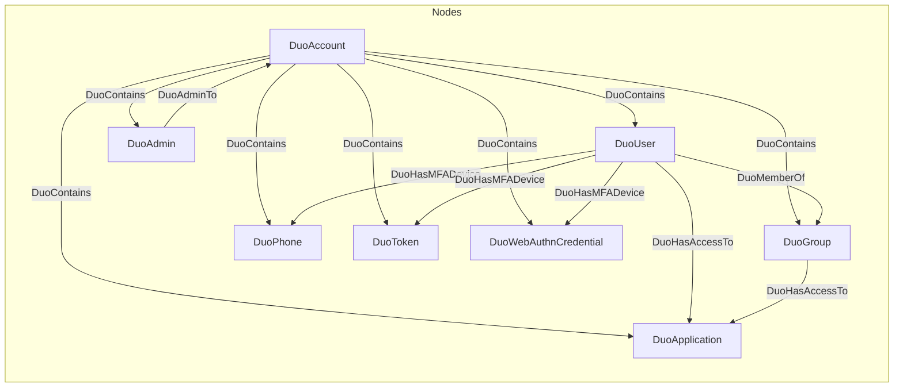

# DuoHound
A BloodHound OpenGraph extension for Cisco Duo Security MFA

## Overview

DuoHound extracts data from Duo Security's Admin API and converts it into BloodHound's OpenGraph format. This data can be used to visualize MFA relationships, identify enrollment gaps, and analyze application access paths.

## Installation

DuoHound uses the official Duo Security Python client, found here: https://github.com/duosecurity/duo_client_python

```bash
pip install duo-client
```

## Setup

### Create Duo Admin API Application

1. Log in to the Duo Admin Panel
2. Navigate to **Applications** → **Protect an Application**
3. Search for "Admin API" and click **Protect**
4. Set permissions to **Grant Resource - Read, Grant Administrators - Read, Grant Read Information**
5. Note your **Integration key**, **Secret key**, and **API hostname**

## Usage

### Basic

```bash
python duohound.py \
  --integration-key YOUR_IKEY \
  --secret-key YOUR_SKEY \
  --api-hostname api-XXXXXXXX.duosecurity.com
```

### Options

| Flag | Description |
|------|-------------|
| `-o, --output` | Output filename (default: `duo_bloodhound_data.json`) |
| `-v, --verbose` | Enable verbose logging |
| `--skip-mfa-details` | Skip per-user MFA token and WebAuthN queries (faster for large environments but incomplete MFA device collection) |
| `--version` | Show version |

### Fast Mode

For large environments (500+ users), collection times may be extended when collecting a user's hardware token and WebAuthN factors. Phones and tablets used with Duo Mobile for MFA will still be collected. To skip detailed MFA device queries:

```bash
python duohound.py \
  --integration-key YOUR_IKEY \
  --secret-key YOUR_SKEY \
  --api-hostname api-XXXXXXXX.duosecurity.com \
  --skip-mfa-details
```

### Import into BloodHound

1. Open BloodHound Community Edition or BloodHound Enterprise
2. Drag and drop the json file into BloodHound's file upload modal.
3. Query your Duo environment using cypher

## Data Model



### Node Properties

| Node | Key Properties |
|------|----------------|
| DuoAccount | `api_hostname`, `account_type` |
| DuoUser | `email`, `status`, `is_enrolled`, `token_count`, `webauthn_count` |
| DuoAdmin | `email`, `role`, `status` |
| DuoGroup | `description`, `push_enabled`, `sms_enabled` |
| DuoApplication | `type`, `integration_key` |
| DuoPhone | `number`, `platform`, `activated`, `capabilities` |
| DuoToken | `token_type`, `serial` |
| DuoWebAuthnCredential | `label`, `authenticator_type` |

## Example Queries

### All Duo Admins

```cypher
MATCH p= (:DuoAdmin)-[:DuoAdminTo]->(:DuoAccount)
RETURN p
```

### Users that are members of Groups

```cypher
MATCH p=(u:DuoUser)-[:DuoMemberOf]->(:DuoGroup)
RETURN p
```

### Users with bypass status (no MFA required)

```cypher
MATCH (u:DuoUser)
WHERE u.status = 'bypass'
RETURN u
```

### Unenrolled users

```cypher
MATCH (u:DuoUser)
WHERE u.is_enrolled = false
RETURN u
```

### Applications accessible by all users (not limited by groups)

```cypher
MATCH p=(u:DuoUser)-[r:DuoHasAccessTo]->(a:DuoApplication)
WHERE r.access_type = 'all_users'
RETURN p
```

### Access paths to a specific application

```cypher
MATCH p = (u:DuoUser)-[*1..]->(a:DuoApplication)
WHERE a.name contains 'VPN'
RETURN p
```

## Security Insights

| Finding | Query Filter | Risk |
|---------|--------------|------|
| Bypass users | `status = 'bypass'` | Can authenticate without MFA |
| Lack of group-restricted access | `access_type = 'all_users'` | Overly permissive app access |
| Unenrolled users | `is_enrolled = false` | No MFA devices registered |
| Weak MFA factor | `capabilities = 'sms'` | Relies on sms-based MFA only |

## Troubleshooting

**No data returned**
- Verify API credentials
- Ensure API application has read permissions
- Check hostname format: `api-XXXXXXXX.duosecurity.com`

**Rate limiting**
- Use `--skip-mfa-details` for large environments

## Future Enhancement Ideas

DuoHound is only collecting a fraction of data available in Duo Security today. Future enhancements will include extending collection to Endpoints, Admin Units, Duo Directory, and Policies.

## Disclaimer

For authorized security testing only. Ensure proper authorization before running against any system.
