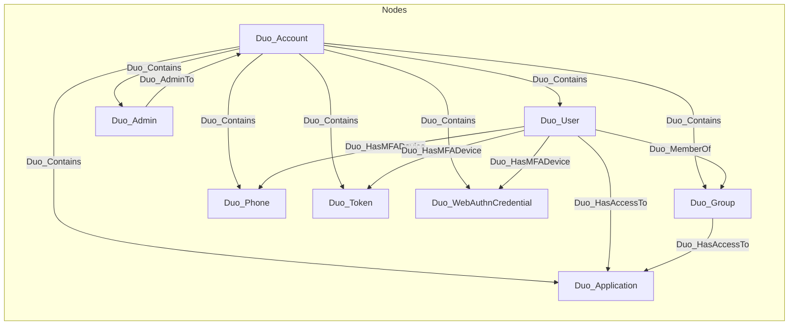

# DuoHound
A BloodHound OpenGraph extension for Cisco Duo Security MFA


## Overview

DuoHound extracts data from Duo Security's Admin API and converts it into BloodHound's OpenGraph format. This data can be used to visualize MFA relationships, identify enrollment gaps, and analyze application access paths.

## Installation

Use Python 3 and the official `duo-client` package on Windows, Linux, or macOS.
Install the Community bundle on BloodHound v9.9.0 or later with a PostgreSQL graph database.

DuoHound uses the official Duo Security Python client, found here: https://github.com/duosecurity/duo_client_python

```bash
python -m pip install -r requirements.txt
```

## Setup

### Create Duo Admin API Application

1. Log in to the Duo Admin Panel
2. Navigate to **Applications** → **Application Catalog**
3. Search for "Admin API" and click **+ Add** (requires a Duo Owner)
4. Set permissions to **Grant resource - Read** and **Grant administrators - Read**
5. Note your **Integration key**, **Secret key**, and **API hostname**

A Duo plan or trial with Admin API access is required. Collection uses read operations;
write permissions are not required. See the [Duo Admin API documentation](https://duo.com/docs/adminapi).

## Usage

### Basic

```bash
python duohound.py \
  --integration-key YOUR_IKEY \
  --secret-key YOUR_SKEY \
  --api-hostname api-XXXXXXXX.duosecurity.com
```

### Options

| Flag | Description |
|------|-------------|
| `--integration-key` | Integration key (environment: `DUO_IKEY`) |
| `--secret-key` | Secret key (environment: `DUO_SKEY`) |
| `--api-hostname` | API hostname (environment: `DUO_HOST`) |
| `-o, --output` | Output filename (default: `duo_bloodhound_data.json`) |
| `-v, --verbose` | Enable verbose logging |
| `--version` | Show version |


### Import into BloodHound

1. Upload [DuoHound-Community-v1.0.0.zip](extension/DuoHound-Community-v1.0.0.zip) through [OpenGraph Management](https://bloodhound.specterops.io/opengraph/extensions/manage).
2. Run the collector and upload `duo_bloodhound_data.json` through BloodHound's data upload modal.
3. Explore the installed saved queries under the DuoHound platform.

The bundle contains [schema.json](extension/schema.json) and
[saved_queries.json](extension/saved_queries.json). Install the bundle separately
from graph data. No Privilege Zone rules are included.

### Upgrading existing data

Owned kinds now use the `Duo_` namespace, for example `DuoUser` becomes `Duo_User`
and `DuoMemberOf` becomes `Duo_MemberOf`. The data source changes from `DuoBase`
to `Duo`; object IDs are unchanged. Recollect and import updated data after
installing the bundle, and update custom Cypher references. Importing new data
does not automatically remove legacy labels or relationships; review any legacy
data cleanup separately.

For future component changes, increment `schema.version`, commit a matching
Community ZIP, update its README link, and upload the new bundle through
OpenGraph Management to update the installed extension.

## Data Model



### Node Properties

| Node | Key Properties |
|------|----------------|
| Duo_Account | `api_hostname`, `account_type` |
| Duo_User | `email`, `status`, `is_enrolled`, `token_count`, `webauthn_count` |
| Duo_Admin | `email`, `role`, `status` |
| Duo_Group | `description`, `push_enabled`, `sms_enabled` |
| Duo_Application | `type`, `integration_key` |
| Duo_Phone | `number`, `platform`, `activated`, `capabilities` |
| Duo_Token | `token_type`, `serial` |
| Duo_WebAuthnCredential | `label`, `credential_name`, `date_added` |

### Relationship semantics

| Relationship | Direction | Traversable | Meaning |
|---|---|---|---|
| `Duo_Contains` | Account → object | No | Organizational containment. |
| `Duo_AdminTo` | Administrator → account | No | Association for all roles and statuses; does not assert tenant control. |
| `Duo_MemberOf` | User → group | Yes | User inherits the group's application eligibility, subject to authentication requirements. |
| `Duo_HasAccessTo` | User/group → application | No | Configured authentication eligibility, not application control. |
| `Duo_HasMFADevice` | User → MFA device | No | Device registration does not establish device possession or control. |

Application access configuration does not prove successful authentication or
control of the protected service. Primary credentials, user state, MFA and policy
remain prerequisites. `Duo_AdminTo` includes limited and disabled administrators;
role-specific control paths are not modeled. MFA registration is deliberately
represented from user to device and is not an impersonation edge.

## Queries

The six existing example queries are maintained in
[saved_queries.json](extension/saved_queries.json). [Browse them in the Query Library](https://queries.specterops.io/?source=https%3A%2F%2Fraw.githubusercontent.com%2Fjulian1j%2FDuoHound%2Frefs%2Fheads%2Fmain%2Fextension%2Fsaved_queries.json&sourceLabel=DuoHound).
The library source will become available after these changes reach upstream `main`.


## Security Insights

| Finding | Query Filter | Risk |
|---------|--------------|------|
| Bypass users | `status = 'bypass'` | Can authenticate without MFA |
| Lack of group-restricted access | `access_type = 'all_users'` | Broad authentication eligibility; review policy and primary authentication |
| Unenrolled users | `is_enrolled = false` | No MFA devices registered |
| Weak MFA factor | `capabilities = 'sms'` | Phone reports SMS capability only; other enrolled factors may exist |

## Troubleshooting

**No data returned**
- Verify API credentials
- Ensure API application has read permissions
- Check hostname format: `api-XXXXXXXX.duosecurity.com`

## Future Enhancement Ideas

DuoHound is only collecting a fraction of data available in Duo Security today. Future enhancements will include extending collection to Endpoints, Admin Units, Duo Directory, and Policies.

## Disclaimer

For authorized security testing only. Ensure proper authorization before running against any system.
